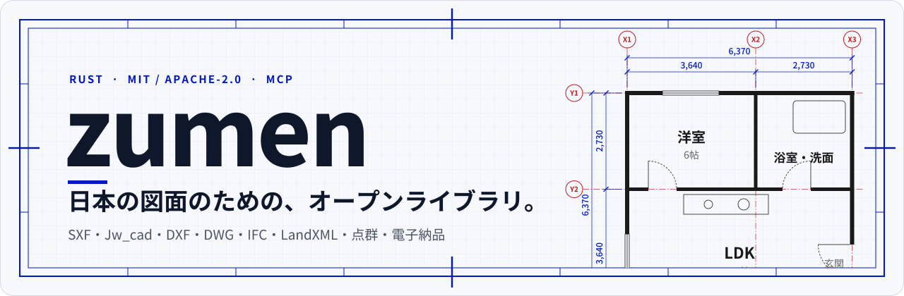

<p align="center">
  <a href="https://zumen.dev">
    <picture>
      <source media="(prefers-color-scheme: dark)" srcset="docs/assets/readme-banner-dark.svg">
      
    </picture>
  </a>
</p>

<p align="center">
  <a href="https://crates.io/crates/zumen"></a> <a href="https://www.npmjs.com/package/@zumen-jp/zumen"></a> <a href="https://pypi.org/project/zumen/"></a> <a href="https://www.nuget.org/packages/Zumen"></a> <a href="#ライセンス"></a>
</p>

<p align="center">
  <b><a href="https://zumen.dev">サイト</a></b>・<a href="https://zumen.dev/viewer/">ビューアー</a>・<a href="https://zumen.dev/formats/">対応形式</a>・<a href="#利用方法">利用方法</a>・<a href="#文書">文書</a>・<a href="docs/releases/0.3.0.md">更新内容</a>
</p>

zumen は、日本の建設のデータ（図面・BIM・土木・点群・納品）を読み書きする、寛容なライセンスのライブラリ群です。Rust の 1 つのコアを、ブラウザー・サーバー・各言語から同じ結果で使います。ファイルは外へ出さずに読みます。

> [!NOTE]
> [v0.3.0](https://github.com/zumen-jp/zumen/releases/tag/v0.3.0) を公開しています。配布先と使い方は下の[「利用方法」](#利用方法)にあります。引き続き開発中で、1.0 までは、壊す変更をリリースノートに書いたうえで、マイナーバージョンで API を変えることがあります。

## 特長

- **どこでも同じ結果。** ブラウザー・サーバー・Python・.NET などで、同じファイルから同じ結果を返します。
- **黙って捨てない。** 読めなかったもの、形を変えて書いたものは、種類と件数と場所を報告します。
- **ID は契約。** 同じバイト列からは、どのバージョンでも同じ ID を返します。
- **受け取ったファイルを信用しない。** 大きさ・数・作業量に上限を付けて読みます。
- **日本の実務を優先する。** 電子納品の SXF、Jw_cad、日本語の文字、国土交通省の基準を先に扱います。

## できること

`main` で動くものです。公開済み v0.3.0 の範囲は、サイトの[対応形式](https://zumen.dev/formats/)をご覧ください。確かめた度合いは形式ごとに違います。実物のファイルとほかの実装で照らしたものも、テストの中で作ったファイルだけで確かめたものもあります。

| 領域 | 形式 | できること |
| --- | --- | --- |
| 図面 | SXF（SFC・P21・SFZ・P2Z）、JWW、DXF、DWG、SIMA、TIFF・GeoTIFF | 要素・レイヤ・線種・用紙を読む。変更を当てて、同じ形式に書き戻す（SXF・JWW・DXF・DWG・SIMA）。DXF に変換する。表示のための 2D のシーンや SVG・PNG を作る。CAD製図基準などのプロファイルの規則でチェックする |
| BIM | IFC（IFC-SPF・ifcZIP）、ST-Bridge、IDS、BCF | IFC を建物モデルとして読み、変更を当てて書き戻す。ST-Bridge（構造）を建物モデルとして読む。IDS で照合する。BCF を読み書きする |
| 土木・地理 | J-LandXML、SIMA、GeoJSON、CityGML（PLATEAU）、基盤地図情報、拡張 DM、GeoTIFF | 線形の上の座標・高さ・勾配を求める。平面図・縦断図・横断図を作る。地物を返し、GeoJSON に書き出す |
| 点群 | LAS・LAZ、PLY、XYZ、E57、GeoTIFF | 読む。設計の面との標高の差を、規格値と比べて集計する |
| 納品 | 電子納品の成果品、工事写真（JPEG）、ボーリング交換用データ | 管理ファイルを読み、プロファイルの規則でチェックする。Exif と XMP、地層と標準貫入試験の値を返す |

- PDF・JWC・JWS・表（xlsx・CSV）は、コアでは扱いません。LAZ は、v0.2.0 では展開を止めていましたが、v0.3.0 で展開を戻しました（[#510](https://github.com/zumen-jp/zumen/issues/510)）。
- 読めなかったもの・形を変えて書いたものは、診断（code・件数・場所）で返します。
- 各形式の権利と、扱わない形式は[形式と権利の一覧](docs/formats/README.md#一覧)で確認できます。

## 利用方法

公開済み v0.3.0 は、各言語のパッケージマネージャーで入れられます。

```bash
cargo add zumen                 # Rust
npm install @zumen-jp/zumen     # TypeScript・JavaScript（ブラウザー・Node.js）
pip install zumen               # Python
dotnet add package Zumen        # .NET
```

<details>
<summary><b>例: Python で DXF を開き、表示のためのシーンを取り出す</b></summary>

```python
from pathlib import Path
from zumen import ZumenError, load, read_scene

zumen = load()
with zumen.open() as session:
    session.push("a.dxf", Path("a.dxf").read_bytes())
    try:
        result = session.call({"v": 1, "op": "open", "input": "a.dxf"})["result"]
        scene = session.call({"v": 1, "op": "scene", "doc": result["doc"], "from": "space/0"})
        columns = read_scene(session.take(scene["result"]["blob"])).columns
        print(columns["chunk_origins"].tolist(), columns["line_xy"].tolist())
    except ZumenError as error:
        # failed の応答は error.response にあり、診断を持ちます
        print(error.status, error.response and error.response["diagnostics"])
```

</details>

<details>
<summary><b>例: Node.js で同じことをする</b></summary>

```js
import { readFileSync } from "node:fs";
import { ZumenError, loadBundled, readScene } from "@zumen-jp/zumen/node";

const zumen = await loadBundled();
const session = zumen.open();
try {
  session.push("a.dxf", readFileSync("a.dxf"));
  const { result } = session.call({ v: 1, op: "open", input: "a.dxf" });
  const scene = session.call({ v: 1, op: "scene", doc: result.doc, from: "space/0" });
  const columns = readScene(session.take(scene.result.blob)).columns;
  console.log(columns.chunk_origins, columns.line_xy);
} catch (error) {
  if (error instanceof ZumenError) {
    // failed の応答は error.response にあり、診断を持ちます
    console.log(error.status, error.response?.diagnostics);
  }
} finally {
  session.close();
}
```

</details>

配布先と使い方は次のとおりです。使い方のリンクは、公開したバージョンの文書です。

| 言語・入口 | 配布先 | 使い方 |
| --- | --- | --- |
| Rust | [crates.io の zumen](https://crates.io/crates/zumen/0.3.0) | [API と例](https://docs.rs/zumen/0.3.0/zumen/) |
| TypeScript・JavaScript | [npm の @zumen-jp/zumen](https://www.npmjs.com/package/@zumen-jp/zumen/v/0.3.0) | [ブラウザー・Node.js](https://github.com/zumen-jp/zumen/blob/v0.3.0/bindings/js/README.md#使い方) |
| Python | [PyPI の zumen](https://pypi.org/project/zumen/0.3.0/) | [Python](https://github.com/zumen-jp/zumen/blob/v0.3.0/bindings/python/README.md#使い方) |
| .NET | [NuGet の Zumen](https://www.nuget.org/packages/Zumen/0.3.0) | [.NET](https://github.com/zumen-jp/zumen/blob/v0.3.0/bindings/dotnet/README.md#使い方) |
| CLI・MCP | [GitHub Release](https://github.com/zumen-jp/zumen/releases/tag/v0.3.0)・[crates.io の zumen-cli](https://crates.io/crates/zumen-cli/0.3.0) | [CLI・MCP](https://github.com/zumen-jp/zumen/blob/v0.3.0/bindings/cli/README.md#使い方) |
| C・C++ | [GitHub Release の C ABI](https://github.com/zumen-jp/zumen/releases/tag/v0.3.0) | [C・C++](https://github.com/zumen-jp/zumen/blob/v0.3.0/bindings/c/README.md#使い方) |

公開済み v0.3.0 の GNU Linux 配布物は glibc 2.28（Python wheel は `manylinux_2_28`）で作られています（[#789](https://github.com/zumen-jp/zumen/issues/789)）。`main`（次のマイナーバージョン以降）は 64 bit の現行環境（GNU Linux は glibc 2.34・`manylinux_2_34`）を対象にします。詳しくは[対応する環境](docs/support.md)をご覧ください。

`main` をソースから試すには、Rust を [rustup](https://rustup.rs/) で入れ（バージョンは `rust-toolchain.toml` で決めてあります）、CLI をビルドして、公開サンプルを開きます。

```bash
cargo build -p zumen-cli
target/debug/zumen capabilities
target/debug/zumen entities samples/dwg/zumen-layout-r2000.dwg --limit 2
```

応答は JSON です。読めなかったものは `diagnostics` に入ります。要求と応答の形は [schema/messages.json](schema/messages.json) に、CLI の使い方は [bindings/cli](bindings/cli/README.md) にあります。

## 使える言語

以下は `main` のバインディングと呼び出し方です。どの言語も、同じ API（数個の関数と、[スキーマ](schema/README.md)で定めた JSON のメッセージ）を通ります。同じ入力から、ビット単位で同じ出力を返すことを、[適合テスト](bindings/conformance/README.md)で確かめます。

| Tier | 言語 | 使い方 |
| --- | --- | --- |
| 1 | Rust | [crates/zumen](crates/zumen) |
| 1 | TypeScript・JavaScript（ブラウザー・Node.js） | [bindings/js](bindings/js/README.md) |
| 1 | Python | [bindings/python](bindings/python/README.md) |
| 1 | .NET | [bindings/dotnet](bindings/dotnet/README.md) |
| 1 | C・C++ | [bindings/c](bindings/c/README.md) |
| 2 | Java・Kotlin | [bindings/java](bindings/java/README.md) |
| 2 | Swift | [bindings/swift](bindings/swift/README.md) |
| 2 | Go | [bindings/go](bindings/go/README.md) |
| 2 | Dart | [bindings/dart](bindings/dart/README.md) |
| 2 | VBA7（Windows、64 bit） | [Microsoft 365 の Excel での使い方と実機の検証結果](bindings/vba/README.md) |
| 3 | Ruby・PHP・PowerShell | C ABI、ネイティブと WASI の CLI、HTTP の[サンプルを毎晩検証](docs/tier3.md) |

- Tier は、言語ごとの対応の約束です（[対応する環境](docs/support.md)）。下限と、確かめる頻度は [docs/support.md](docs/support.md) にあります。
- CLI の `zumen` は、同じ要求を標準入出力と HTTP で受け、MCP のサーバーにもなります。AI のアプリからも使えます。

## 文書

| 文書 | 中身 |
| --- | --- |
| [docs/formats](docs/formats/README.md) | 形式と権利の一覧（台帳から生成）と、形式ごとの知見 |
| [docs/support.md](docs/support.md) | 対応する環境と、言語の下限 |
| [docs/tier3.md](docs/tier3.md) | 公式のラッパーのない言語から使う手順 |
| [docs/view2d.md](docs/view2d.md) | 2D の表示部品の機能の一覧 |
| [docs/render.md](docs/render.md) | 図面から SVG・PNG を作る API と、Node.js の例 |
| [docs/live.md](docs/live.md) | 対話の編集に向けた文書エンジンの設計と、試作の測定 |
| [schema](schema/README.md) | API の関数とメッセージのスキーマ |
| [catalog](catalog/README.md) | 診断の code と、日本語・英語の文 |
| [コアの設計](docs/architecture.md) | モデルの層、書き出しの経路、決定性、予算 |
| [#1](https://github.com/zumen-jp/zumen/issues/1) | 設計と計画（子 issue に分けている） |
| [CONTRIBUTING.md](CONTRIBUTING.md) | 開発への参加。エージェント向けの規則は [AGENTS.md](AGENTS.md) |
| [docs/style.md](docs/style.md) | 表記と用語の基準 |
| [SECURITY.md](SECURITY.md) | 脆弱性の知らせ方 |

サイトは <https://zumen.dev> で公開しています（元は [site](site/README.md)）。

## ライセンス

次のどちらかを選んで使えます。

- MIT License（[LICENSE-MIT](LICENSE-MIT)）
- Apache License 2.0（[LICENSE-APACHE](LICENSE-APACHE)）

`samples/` の公開サンプルは、[samples/ledger.toml](samples/ledger.toml) に書いたそれぞれのライセンスに従います。

明示しない限り、このリポジトリへの貢献は、Apache License 2.0 の定める「貢献」（Contribution）として、追加の条件なしに上の 2 つのライセンスで提供されたものとします。
